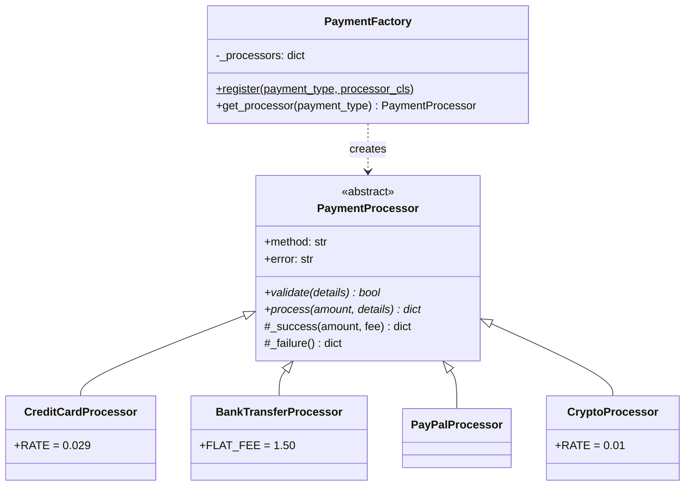
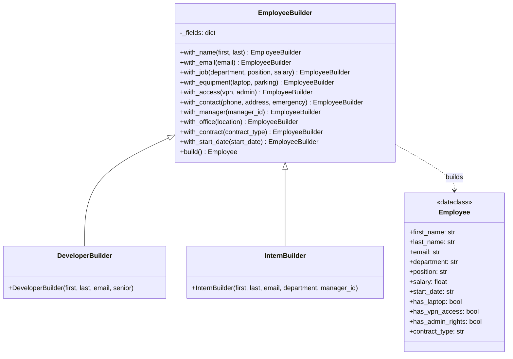
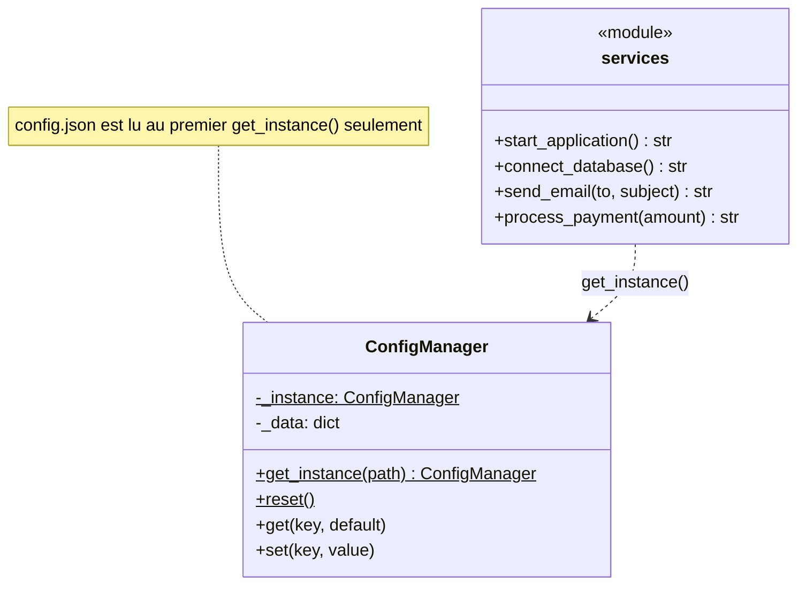
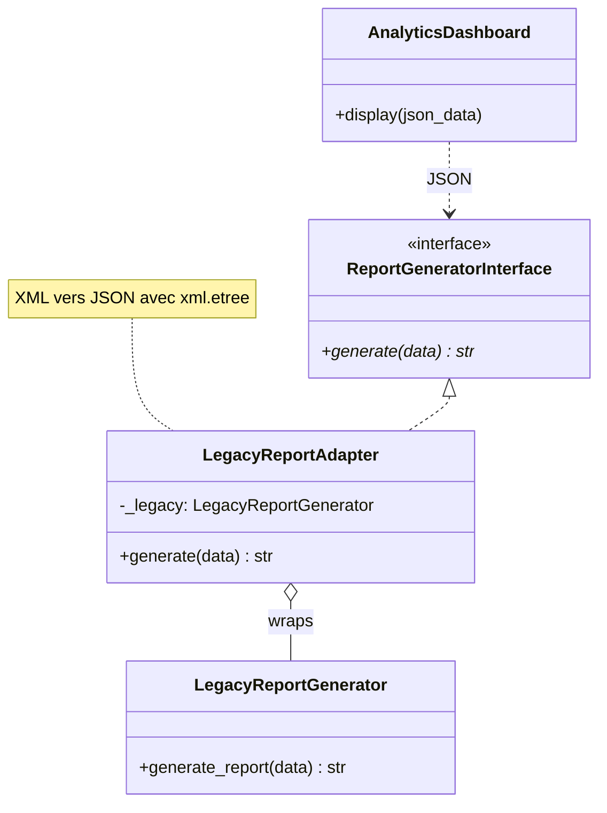
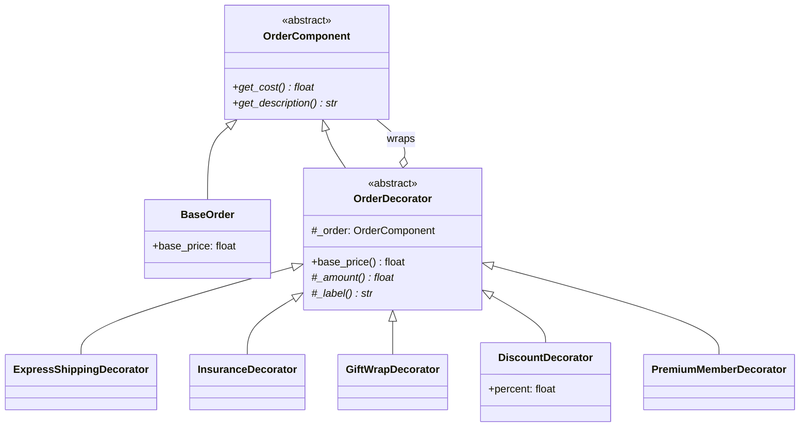
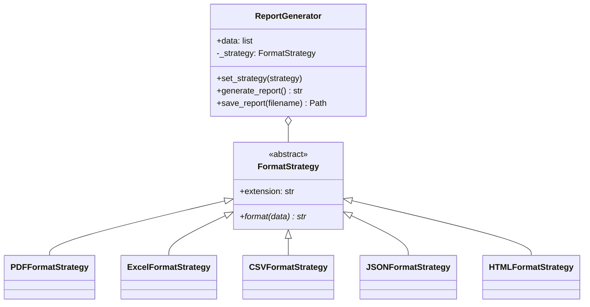
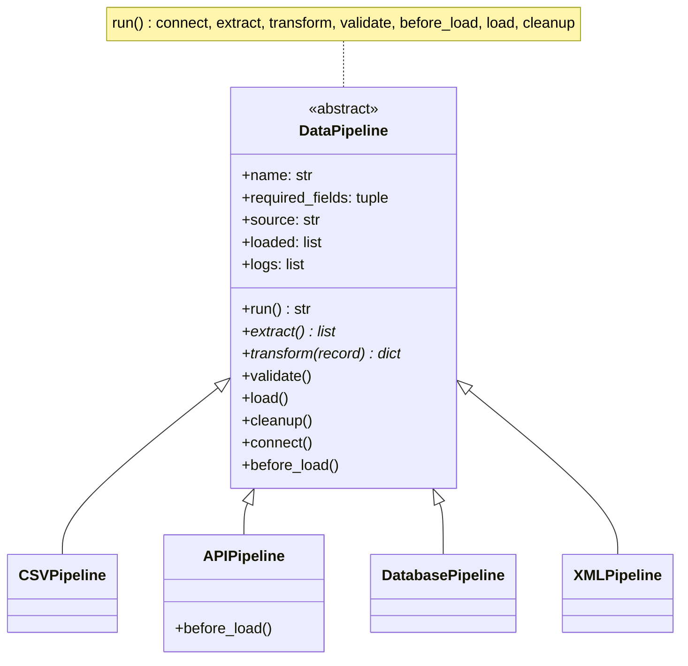

# Design patterns in practice (slide 84)

Énoncés : les trois pages du cours, [creational](https://courses.dallard.tech/sys_design/creational_pattern/), [structural](https://courses.dallard.tech/sys_design/structural_pattern/) et [behavioral](https://courses.dallard.tech/sys_design/behavioral_pattern/). Elles donnent sept exercices : chacun part d'un code « spaghetti » à refactorer avec un pattern imposé. Un fichier par exercice, avec une démo dans son `if __name__ == "__main__"`.

| Famille | Pattern | Exercice | Fichier |
|---|---|---|---|
| Creational | Factory Method | Système de paiement | `factory_payment.py` |
| Creational | Builder | Onboarding RH | `builder_employee.py` |
| Creational | Singleton | Gestionnaire de config | `singleton_config.py` + `config.json` |
| Structural | Adapter | Rapport XML vers dashboard JSON | `adapter_report.py` |
| Structural | Decorator | Prix d'une commande | `decorator_order.py` |
| Behavioral | Strategy | Formats de rapport | `strategy_report.py` |
| Behavioral | Template Method | Pipeline ETL | `template_etl.py` |

```bash
python3 factory_payment.py   # démo d'un exercice
python3 -m unittest -v       # 29 tests (pytest les lance aussi)
```

Les diagrammes ci-dessous ont été faits avant le code, comme le demande le cours.

---

## 1. Factory Method : paiements

Le code d'origine met les trois moyens de paiement dans un seul `if/elif`. Ajouter Apple Pay ou la crypto oblige à rouvrir cette fonction, ce qui viole le principe ouvert/fermé.



La factory associe chaque nom à sa classe dans un dictionnaire, sans `if/elif`. `CryptoProcessor` montre l'extension : une classe en plus et un appel à `register()`, sans toucher au reste. Un type inconnu lève `ValueError` au lieu de renvoyer un dict d'erreur qu'on peut oublier de lire.

## 2. Builder : onboarding RH

`create_employee()` prend 17 arguments positionnels. Un `None` oublié décale tous les suivants, et rien ne garantit qu'un senior ait les droits admin.



Le diagramme ne montre pas les champs optionnels (`phone`, `address`, `manager_id`…). Toute la validation est dans `build()`. Les presets portent les règles métier : un `DeveloperBuilder(senior=True)` a toujours les droits admin, un stagiaire a toujours un manager et un contrat `internship`. Un preset reste modifiable par la suite (`.with_office("Lyon")`).

## 3. Singleton : configuration

`load_config()` relit `config.json` à chaque appel : quatre lectures pour une requête, et une modification faite dans un module n'est pas vue par les autres.



`get("database.host")` descend dans le JSON et renvoie `default` si la clé manque. `reset()` ne sert qu'aux tests : le test `test_file_read_only_once` remplace `open` par un `mock_open` et vérifie qu'il n'est appelé qu'une fois. Le `api_key` du `config.json` est un faux.

## 4. Adapter : rapport XML pour un dashboard JSON

Le générateur historique renvoie du XML et ne peut pas être modifié. Le dashboard attend du JSON. Dans le code d'origine, chaque fonction refait la conversion, en trichant : elle repart des données d'origine et n'utilise pas le XML.



L'adaptateur lit vraiment le XML (`xml.etree.ElementTree`) et rend leur type aux nombres : sans ça, `1234` reviendrait sous forme de texte `"1234"`.

## 5. Decorator : prix d'une commande

Cinq booléens dans `calculate_total()`, une méthode qui fait tout, et un ordre de calcul implicite (la remise s'applique-t-elle avant ou après les frais de port ?).



Chaque décorateur n'écrit que son montant et son libellé, la classe mère ajoute ce montant au coût de l'objet emballé. L'ordre d'emballage devient l'ordre du calcul, et un test le vérifie. L'assurance reste à 5 % du prix des articles, comme dans le code d'origine, d'où la propriété `base_price` transmise à travers les couches. Avec toutes les options et 15 % de remise, on retrouve le total de l'ancien code : 95,625 €.

## 6. Strategy : formats de rapport

Problèmes relevés dans le code d'origine :

- ajouter un format (XML, Markdown) oblige à modifier `generate_report()` et `save_report()` : deux chaînes de `if/elif` à tenir à jour, en violation du principe ouvert/fermé ;
- on ne peut pas tester un format sans passer par toute la classe ;
- un format inconnu renvoie la chaîne `"Unknown format"` comme si c'était un rapport, et `save_report()` n'écrit alors rien, sans erreur ;
- le choix du format passe par une chaîne libre, une faute de frappe ne se voit qu'à l'exécution.



Chaque stratégie connaît sa propre extension, donc `save_report()` n'a plus de `if`. `HTMLFormatStrategy` a été ajoutée à la fin sans modifier aucune autre classe, ce qui était le test final de l'énoncé. Comme dans le code d'origine, les fichiers `.pdf` et `.xlsx` restent du texte.

## 7. Template Method : pipeline ETL

Problèmes relevés dans le code d'origine :

- la validation, le chargement et le nettoyage sont copiés trois fois ; les trois `run()` ne diffèrent que par l'extraction et la transformation ;
- ajouter du logging ou changer l'ordre des étapes oblige à modifier les trois classes ;
- si la validation échoue, le nettoyage n'a jamais lieu ;
- rien n'empêche une nouvelle classe d'oublier une étape.



`run()` est la méthode template, la seule qui fixe l'ordre. Les sous-classes écrivent `extract()` et `transform()`. `connect()` et `before_load()` sont des hooks : ils ont un comportement par défaut, et `APIPipeline` redéfinit `before_load()` pour trier par score. `cleanup()` est dans un `finally`, il tourne même quand la validation échoue. `XMLPipeline` sert de vérification : il n'écrit que ce qui lui est propre. Les `time.sleep(0.5)` du code d'origine ont été retirés, et les messages vont dans `self.logs` plutôt que dans `print` pour pouvoir être testés.
